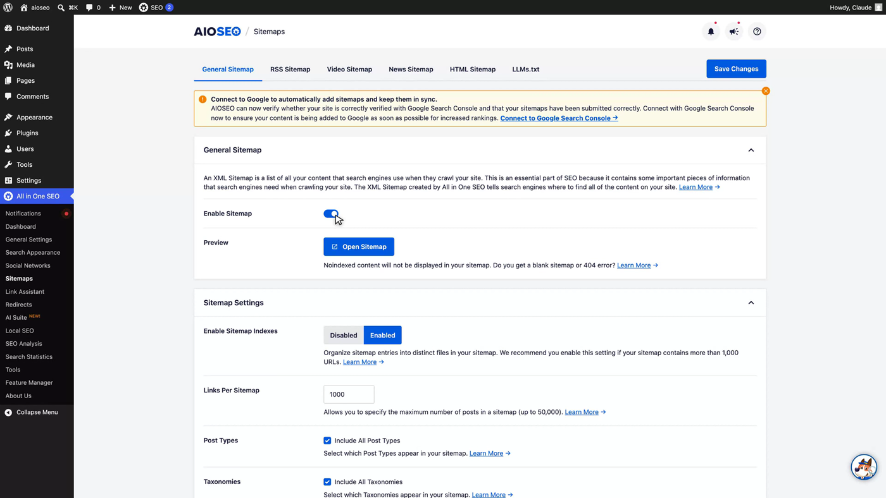

# WordPress Tutorial Video

A [Claude Code](https://claude.com/claude-code) skill that turns a **WordPress
documentation URL** into a finished, narrated, captioned tutorial **MP4** —
recorded against your own WordPress site.

Give it a doc URL and a running WordPress site with an admin login. It reads the
doc, writes a beginner-friendly scene script, generates the voiceover, discovers
the real UI selectors on your live site, records one short clip per scene, composes
everything with FFmpeg, verifies that the narration matches what's on screen,
auto-fixes the scenes that don't, and hands you the final video.

Works for **any** WordPress plugin, theme, or admin feature. The only assumption is
that the target is WordPress.

> **Status:** macOS only (Apple Silicon recommended). Free to use.
> No paid dependencies.

## How it works

```
doc URL ─▶ parse ─▶ script ─▶ voiceover ─▶ audio gate (WER) ─▶ discover selectors
        ─▶ record scenes (2x master) ─▶ post-process ─▶ compose (FFmpeg)
        ─▶ vision verify ─▶ MP4 (+ chapters + captions)
```

Three ideas make it reliable:

1. **The script is the spine.** Everything hangs off a scene JSON contract.
2. **Audio first.** Each scene's clip is paced to its narration length
   (`max(clip, narration)`), so audio and video never drift. Actions can even be
   cued to the exact spoken word ("…click **Save Changes**").
3. **Verify before you spend.** Every scene's voiceover is transcribed back and
   diffed against the script *before* recording starts; a vision check validates
   each recorded scene afterwards, and only failing scenes are re-made.

## Sample output

A frame from a fully machine-generated and machine-verified pilot video (AIOSEO's
XML Sitemaps doc, recorded on a local WordPress site — note the glide cursor
resting on the toggle the narration is describing):



The finished MP4 ships with narration at −16 LUFS, aligned soft captions built
from the script text, embedded chapter markers (one per scene), and a
`verify/report.json` proving every scene passed both the audio-transcript diff
and the vision check.

## Requirements

- **macOS** (Homebrew). Apple Silicon recommended.
- A reachable **WordPress site** with an admin login and the feature already set up.
  The skill records your site — it does not create one.
- Node ≥ 18 and Python 3. Everything else is installed by the bootstrap script.

## Install

```bash
git clone <this-repo> wordpress-tutorial-video
cd wordpress-tutorial-video
bash scripts/bootstrap.sh        # ffmpeg, uv venv (Kokoro + WhisperX), Playwright + Chromium
bash scripts/check_env.sh        # confirm everything is present
```

To use it as a personal Claude Code skill, place this directory in your skills
folder (e.g. `~/.claude/skills/wordpress-tutorial-video`).

## Usage

In Claude Code, point the skill at a doc and your site:

> "Use the wordpress-tutorial-video skill to make a tutorial from
> `https://example.com/docs/xml-sitemaps/` against my site `https://my-wp.test`."

Provide admin credentials via environment variables (referenced by name in
`config.json`, never stored in the repo):

```bash
export WP_ADMIN_USER="admin"
export WP_ADMIN_PASS="…"
```

The skill creates `runs/<slug>/`, runs the pipeline step by step, and writes the
result to `runs/<slug>/output/final.mp4`.

## Premium narration (optional)

The local voices are free and need nothing extra. For the most natural read,
the skill can voice the video with ElevenLabs instead:

```bash
export ELEVENLABS_API_KEY=...   # in your shell profile; the skill never stores it
```

Then tell Claude you want **Premium narration**. It lists the voices on your
account, records a short audition of a few so you can pick by ear, shows what
the video will bill before spending anything (about one character per
character of narration — roughly 2,000–2,500 for a 3-minute tutorial), and
voices each scene in one natural take. What you get on top of the voice:

- **Deliberate pauses.** The pause after every sentence and paragraph is
  lengthened to your channel's pacing, on the audio itself, so the read stays
  natural.
- **Product names said right, and checked.** Respellings pin coined names
  (`"TruSEO": "True SEO"`), and the audio gate re-listens to each one without
  hints, because a mispronounced name otherwise slips through.
- **Exact timing.** Clicks and captions use the service's own per-word
  timestamps.
- **No surprise bills.** Takes are cached per scene: re-runs and pacing or
  speed changes are free, and a one-scene fix bills one scene.

Only the narration text is sent to ElevenLabs; the recording and your site
stay on your Mac. Details: [references/voices.md](references/voices.md).

## Configuration

See `config.json` in [SKILL.md](SKILL.md#inputs--configjson). Key knobs:

| Setting | Default | Notes |
|---------|---------|-------|
| `resolution` / `fps` | `1920x1080` / `30` | Delivery resolution, 16:9. |
| `capture_scale` | `2` | Records a 2x (4K) master for crisp text; `deliver_4k: true` also outputs full 4K. |
| `voice` / `speed` | `af_heart` / `0.9` | Kokoro voice + pace (see [references/voices.md](references/voices.md)). |
| `engine` | `chatterbox` | `chatterbox` / `kokoro` run locally and are free; `elevenlabs` is the premium voice (needs `ELEVENLABS_API_KEY`). |
| `elevenlabs_voice` / `elevenlabs_model` | `Eric` / `eleven_v4` | Premium narrator and model. Pick the voice by ear with `tts_elevenlabs.py --audition`. |
| `tts_spoken` | `{}` | Respellings for product names (`{"TruSEO": "True SEO"}`). Captions keep the real spelling; the audio gate checks the name is heard correctly. |
| `lexicon` | `{}` | Pronunciation overrides (term → IPA) merged with [references/lexicon.json](references/lexicon.json). |
| `chapter_cards` | `false` | Per-scene blur cards off; scene intents become MP4 chapter markers. |
| `transitions` | `"none"` | `"fade"` enables crossfades (re-encode). |
| `verify` | `full` | `full` (audio gate + vision), `text` (audio gate only, free), or `off`. |
| `verify_sample` | `0` | Run the vision check on N scenes only (0 = all). |
| `wer_threshold` | `0.15` | Max per-scene word error rate at the audio gate. |
| `max_fix_iterations` | `2` | Cap on auto-fix rounds. |
| `allow_destructive` | `false` | Recorder refuses delete/deactivate/… clicks unless enabled. |
| `redact_selectors` / `redact_patterns` | `[]` | Blur secrets (emails, license keys) while recording. |

## Cost note

The verification loop sends a frame per scene to Claude vision — that's the
credit-heavy step, and it's on by default for quality. Dial it down with
`verify=text`, `verify_sample`, or `verify=off`. The audio gate (per-scene
transcript diff), captions, and chapters are local and free.

## The stack

| Layer | Tool |
|-------|------|
| Parse & script | Claude Code |
| Voiceover | [Kokoro-82M](https://huggingface.co/hexgrad/Kokoro-82M) + espeak-ng, or Chatterbox — local and free. Premium option: [ElevenLabs](https://elevenlabs.io) (Eleven v4) with your own API key |
| Audio gate & alignment | [WhisperX](https://github.com/m-bain/whisperX) (faster-whisper fallback) |
| Record | Playwright `page.screencast` (≥ 1.59), 2x device-scale master |
| Compose | FFmpeg (single-encode pipeline, loudness-normalized, MP4 chapters) |
| Visual verify | Claude vision |

## Limitations

macOS only · WordPress admin only · needs a user-provided configured site ·
verification consumes credits (tunable) · Kokoro is English-leaning · premium
narration needs your own ElevenLabs plan and bills per character.

## Development

```bash
python3 -m pytest -q          # python steps (ffmpeg tests skip if ffmpeg absent)
node tests/test_record_scene.mjs   # recorder against a static fixture (no WordPress)
```

CI runs both on macOS for every push/PR (`.github/workflows/ci.yml`). TTS and
transcription have `--engine stub` modes so the suite needs no ML downloads.
